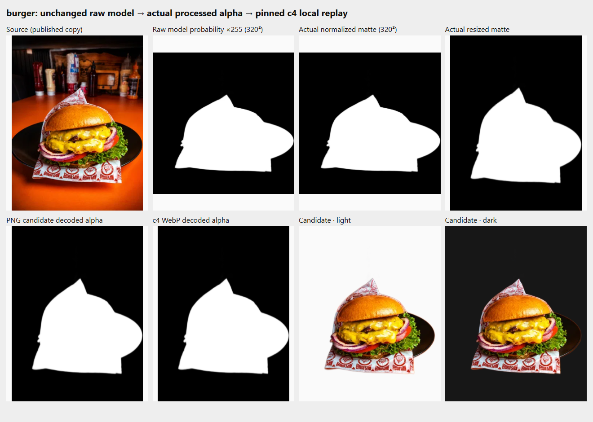
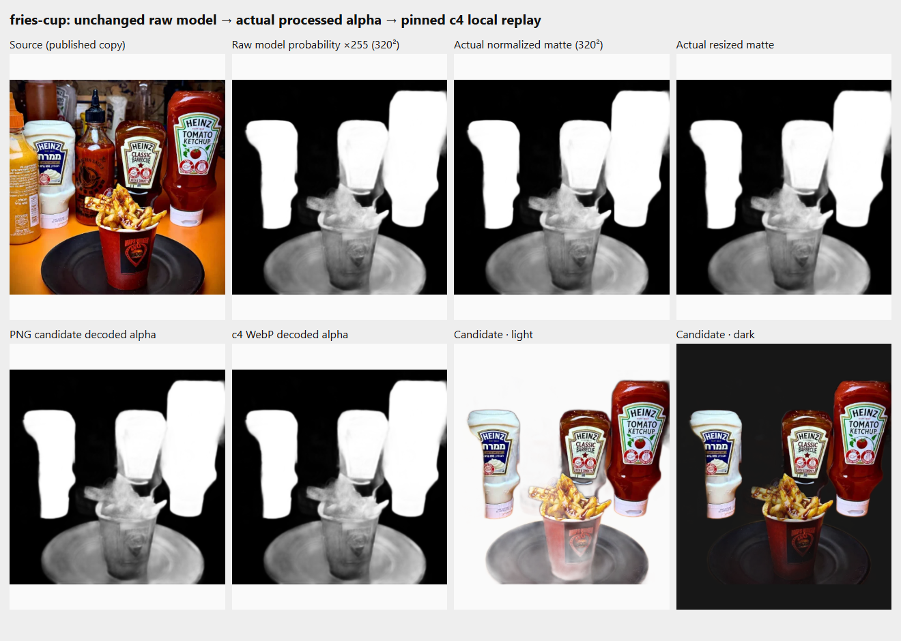
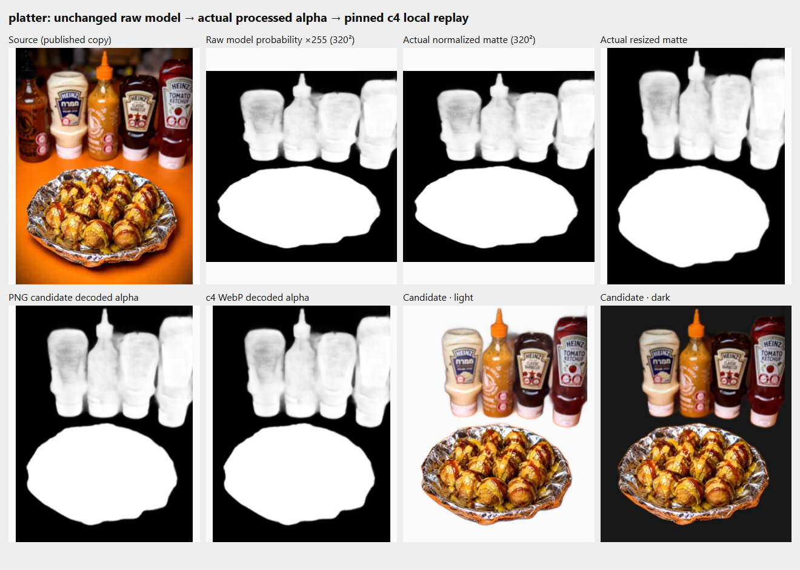

# PR380 image-quality comparison

This follow-up preserves the accepted neutral scene, four visual color pickers,
appearance persistence, legacy contracts and tenant isolation. It does not change
the Storefront design, public asset budgets or c4 quality/size limits. The PR stays
Draft: no hosted SQL, merge, Production deployment or live merchant changes.

| Review area | Disposition | Evidence |
| --- | --- | --- |
| Scene and color pickers | Retained from the reviewed e006ee2f candidate. Current-source checks must still pass; no redesign is included. | [PR380 checks and exact source](https://github.com/salehzarora/RestoFlow/pull/380), existing full appearance lifecycle. |
| Automatic cutout quality | **Not accepted. Disabled by default.** Original upload/review/explicit publication remain available. | [Raw mask → processed alpha → c4 diagnosis](cutouts/README.md), with original bytes and all stage images. |
| Genuine high-resolution quality | Separate from mask acceptance. The camera source is not a w480 derivative and is never enlarged as claimed detail. | [2816×2112 source, provenance and measured c4 files](highres/README.md); the PR links the final-source real-service receipt and downloadable artifact. |

The current PR description identifies the exact checked head, run and artifact.
Source-bound GitHub links make these files accessible without a local C: drive.
The full Actions artifact requires GitHub access and has its stated retention
period; the committed source/diagnostic files remain in the repository history.

## Burger, fries cup and platter

These are the actual existing published source copies. Each board separates the
source, raw model output, mask processing, final alpha, published alpha, and
actual light/dark composites. They are failed preservation examples, not cleaned
replacement photographs. There is no generated food or manually repaired mask.

### Burger — part of the serving plate is lost

### Fries cup — cup/plate becomes translucent while bottles remain

### Platter — background bottles remain

The measured cup region's strongest raw score (0.7082) is below the unwanted
bottle region's weakest (0.9951). Burger's missing plate is already nearly zero
in the raw Float32 output. Global opacity/threshold changes cannot distinguish
those objects correctly. Actual normalization changes at most one 8-bit level;
resized-mask → PNG alpha and PNG → c4 alpha change zero pixels in the local replay.
No speculative alpha correction or replacement model is adopted.

The Windows diagnostic output is not represented as byte-identical to Linux CI.
The [diagnosis](cutouts/README.md) records both chains and their hash differences.
Raw observation hooks reproduce the prior uninstrumented local worker output.
Fresh service results establish transport/publication behavior, not acceptable
segmentation merely because a test passes.

## Genuine source-to-display comparison

The [high-resolution evidence](highres/README.md) uses Miansari66's CC0 camera
photograph, unmodified at 2816×2112 / 4,989,591 bytes. The source and exact
provenance are downloadable from this repository. The original-to-c4 local
outputs are truly 480×360 / 39,588 bytes and 960×720 / 112,324 bytes, derived
independently from the original, with quality 82 and no variant cascade.

The final-source service artifact's `quality-highres.json` records the actual
private original, processed candidate, decoded public variants and rendered
390/1440 views at DPR1/2/3. Its screenshots and source-versus-display boards
separate the genuine source from the actual browser result. The PR provides the
run/artifact link and actual result; no service success is inferred from offline
codec files. The 960-pixel publication cap remains: it can undersupply desktop
DPR3. Original preservation does not mean unlimited public resolution.

## Default operation and resource impact

`ProductCutoutEditor` now defaults `SF_PRODUCT_CUTOUT_REVIEW` to false. It loads
Original without calling the processor and still requires an explicit publish
action. Changing policy while a candidate is selected or processing cancels and
invalidates the candidate. Failed/cancelled processing does not publish anything.
Already-transparent inputs stay out of segmentation in the review-enabled path.

The ordinary menu image picker/upload remains independent. A review-enabled
device missing required browser APIs or reporting less than 4 GB RAM is refused
before creating a worker, decoding the image or fetching the model. The UI gives
a fixed localized explanation and keeps Original available. This preflight does
not measure free RAM or prove universal mobile support.

The isolated service build explicitly enables `SF_PRODUCT_CUTOUT_REVIEW=true` to
exercise experimental processing/publication. Separate tests exercise the actual
default-false constructor and no-inference behavior. Do not treat the experimental
CI build as release-default automatic removal.

No model, dependency, publication recipe, input cap or public Storefront budget is
changed. Default processing/model download is zero; the optional experiment still
uses the same approximately 188 MB lazy editor assets, one worker, 120-second
timeout and 512 MiB WASM heap limit. The genuine high-resolution preflight measured
about 1.40 GB peak Chrome process-tree working set and 1.22 GB private memory;
the smaller earlier examples measured about 1.18 GB working set. These are local
measurements, not a hard browser-memory cap. Diagnostic files and source photos
are documentation/test assets, outside Storefront public assets.

See [runtime, licenses and exact limits](../../../apps/dashboard/cutout/README.md).

## Focused changes and verification

- Editor policy, separate Original load/publication, fixed unavailable-device
  explanation and stale/late-candidate guards; ordinary upload unchanged.
- Bridge capability/memory preflight before worker/decode/model activity.
- Default/unsupported/late-result regressions; the existing upload/storage,
  candidate, retry, cancellation and publication checks remain.
- Observation-only mask runner and genuine high-resolution service/display
  evidence. No model graph, alpha processing, SQL, publisher or CSS correction.

Local focused results and independent review are recorded in PR380, followed by
the required normal CI and full isolated real-service run on the final source.
No older-head PASS is transferred to that source. Exact changes, current checks,
service artifact and high-resolution acceptance are consolidated in the PR body.
