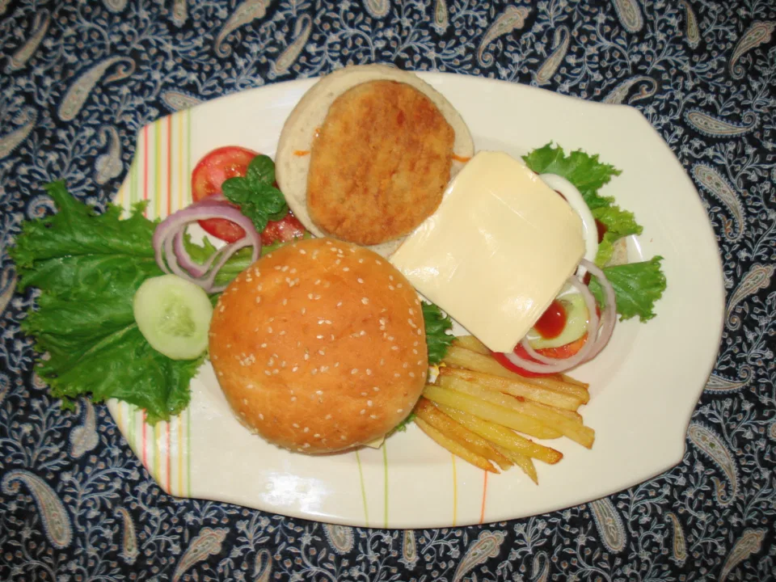

# Genuine high-resolution photograph

This is a new licensed camera photograph for measuring the original-to-display
pipeline. It is not a higher-resolution replacement for any of the owner's four
product photos. The unchanged source JPEG is
[committed as the integration fixture](../../../../e2e/cinematic/fixtures/product-cutout/burger-highres.jpg).

**Source:** [“Hamburger (9).jpg”, Miansari66](https://commons.wikimedia.org/wiki/File:Hamburger_(9).jpg),
author's own photograph, [CC0 1.0](https://creativecommons.org/publicdomain/zero/1.0/).
[The provenance receipt](provenance.json) pins the source revision, original
download URL, byte length, dimensions, orientation and hashes. Its 2816×2112
pixels / 4,989,591 bytes fit the existing 8 MiP / 5 MiB limits. Nothing was
generated or enlarged to make this source.

## Available offline codec evidence

These are actual outputs of the unchanged, hash-verified `storefront-media-c4`
engine, each independently derived from the original JPEG. They are review
files, not hosted/publication receipts. No production data was written.

| Resource | Actual dimensions | Bytes | Recipe |
| --- | --- | ---: | --- |
| [Original c4 small](original-c4-w480.webp) | 480×360 | 39,588 | quality 82, rung 0 |
| [Original c4 large](original-c4-w960.webp) | 960×720 | 112,324 | quality 82, rung 0 |



[Exact output hashes](offline-original-receipt.json) and the
[reproduction script](derive-original.mjs) are included. From the checkout root:

```sh
node docs/visual-references/PR380-quality-review/highres/derive-original.mjs
```

This photograph has normal camera softness/flash lighting. Higher dimensions
alone do not establish optical sharpness, a clean segmentation mask or pixel
coverage on every display.

One [local actual-worker preflight](local-worker-receipt.json) also processed
these exact source bytes with the cached pinned model: 1600×1200 PNG,
1,262,814 bytes, 30.663 seconds. The sampled whole Chrome process-tree peak was
1,401,290,752 bytes working set and 1,219,903,488 bytes private memory. This fits
the unchanged output/time limits, but is not a universal device-memory bound,
real-service publication result or acceptance of its mask. No second processor
run was performed just to produce another measurement.

## Real-service journey and limits

The extension in `e2e/cinematic/product-cutout.spec.ts` runs only in the existing
disposable Actions stack, with `SF_PRODUCT_CUTOUT_REVIEW=true` explicitly set
by its build. Default application background removal remains unavailable.
This extension's service results require a fresh Actions run after integration;
the existing PR's earlier successful run does not establish the new source case.

The fifth pass reuses synthetic TEST 1 after the four existing photos. It uploads
the genuine source through the normal editor, processes it with the actual
worker, publishes the experimental selection, then publishes Original. Each
step records byte lengths, hashes and decoded dimensions. The private original
must remain byte-identical after both publications.

`quality-highres.json` and `quality-highres-*.png` in the resulting Actions
artifact record the actual shipped menu at 390px and 1440px widths, each at DPR
1, 2 and 3. The receipt includes `currentSrc` path, real response hash, decoded
resource dimensions, density-corrected DOM natural size, image box, `contain`
painted size/aspect, filters, `sizes`/`srcset`, and supplied/required device-pixel
ratio. It observes the normal 60-second cache; no response, product DOM or CSS is
fabricated. Public decoded previews and the actual worker PNG are included.

At 390px and 1440px viewport widths, DPR 2, the Original treatment also emits
`quality-highres-source-vs-display-*-dpr2.png`: the genuine camera JPEG downsampled
to the measured screenshot crop's physical pixel size beside the actual browser
crop copied at 1:1 pixels. Composition uses a separate blank canvas page, never
the application DOM. Centered `contain`, viewport bounds and five unobscured hit
points are checked first. The receipt records CSS crop geometry, actual PNG
dimensions, DPR and hashes, and verifies the board's displayed panel preserves
all captured pixels. The source reference is labeled as a downsample, with no
claim of recovered detail. The untouched screenshot crops are also artifacts.

The recipe still caps the longest side at 960 pixels. A desktop 448 CSS-pixel
wide image at DPR 3 requires 1344 pixels, so its maximum 960-pixel resource can
only supply about 71% of that width. The receipt reports the measured cap; the
test does not silently upscale a source or raise the recipe budget.

Segmentation remains experimental. Transport/publication/density assertions do
not judge whether the mask retains food, plate, cup or intended shadows. Original
is the available fallback; review the actual light/dark editor screenshots and
processed bytes before accepting any mask.
